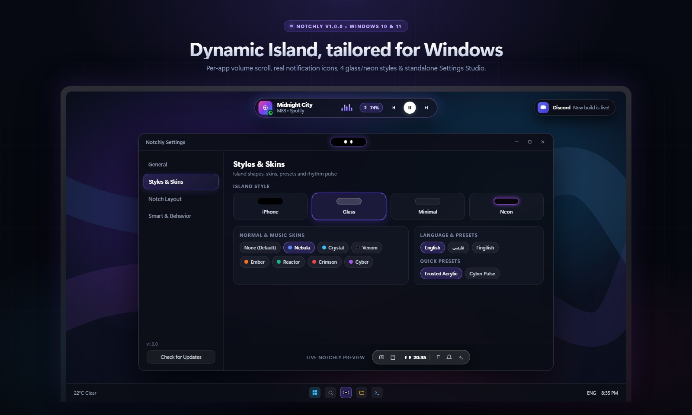

<div align="center">

# Notchly

**A living Dynamic Island studio for Windows 10 & 11.**
Media controls with per-app volume scroll, real app icons on notifications, 4 glass &amp; neon styles, and a standalone Settings Studio — crafted with Rust &amp; Tauri.

[](https://github.com/AmirAbbas8585/Notchly/releases/latest)
[](https://github.com/AmirAbbas8585/Notchly/releases)
[](https://github.com/AmirAbbas8585/Notchly/actions/workflows/build.yml)

[](LICENSE)

<p>
  <a href="https://github.com/AmirAbbas8585/Notchly/releases/latest/download/Notchly-Setup.exe">
    
  </a>
  <a href="https://github.com/AmirAbbas8585/Notchly/releases/latest/download/Notchly-Portable.exe">
    
  </a>
  <a href="https://github.com/AmirAbbas8585/Notchly/releases/latest/download/Notchly-Windows.zip">
    
  </a>
</p>

[English](#highlights) &nbsp;&bull;&nbsp; [فارسی](#فارسی)

<br />



</div>

---

## Highlights

<table>
  <tr>
    <td width="50%" valign="top">
      <h3>🎛️ Standalone Settings Studio</h3>
      <p>
        Configure every detail inside a dedicated frameless window that mirrors your chosen island style, remembers its dimensions across restarts, shows an interactive centered mini-notch in the title bar, and previews changes live on the bottom dock.
      </p>
    </td>
    <td width="50%" valign="top">
      <h3>🔊 Per-App Music Volume Scroll</h3>
      <p>
        Scroll the mouse wheel over the island in Music mode to turn <b>only the playing app</b> (Spotify, browser, media player) up or down via WASAPI audio sessions — leaving your Windows master volume untouched.
      </p>
    </td>
  </tr>
  <tr>
    <td width="50%" valign="top">
      <h3>🎨 4 Styles &amp; 14 Unified Skins</h3>
      <p>
        Switch between <b>iPhone</b>, <b>Glass</b>, <b>Minimal</b>, and <b>Neon</b> shapes, combine any of <b>14 skins</b> (plus <code>None (Default)</code>) independently for Normal &amp; Music modes, or apply one-click <b>Quick Signature Presets</b>.
      </p>
    </td>
    <td width="50%" valign="top">
      <h3>🔔 Notifications with Real App Icons</h3>
      <p>
        Resolves genuine application icons from UWP <code>AppsFolder</code>, Registry AUMIDs, Start Menu shortcuts, and running executables — both in toast banners and on the album art badge in Music mode.
      </p>
    </td>
  </tr>
</table>

---

## What's Inside

- **Drag & Drop Toolbar Layout (`Notch Layout`)**: Reorder every island action (`Screenshot`, `Clipboard`, `Music Mode`, `Play / Pause`, `Quick Notes`, `File Shelf`, `Notifications`, `Settings`) across Left Side, Right Side, or Hidden Tools.
- **Trilingual UI & Multi-Calendar Support**: Instant switching between **English**, **فارسی (RTL)**, and **Fingilish**, paired with **Gregorian**, **Shamsi**, **Shamsi FA**, or dual calendars.
- **Smart Copy & Clipboard History**: Automatically detects copied links, math expressions, Gregorian ⇄ Shamsi dates, and hex color swatches, with an optional copy-preview HUD and searchable clipboard history.
- **Quick Notes (`Ctrl + Alt + N`) & Reminders**: Capture single-line notes from any window; phrases containing a time turn into countdown reminders.
- **File Shelf**: Drag files onto the notch to keep them accessible side by side and drag them back out into any app.
- **Fullscreen & Window Awareness**: Automatically stays out of the way during fullscreen videos or games and hides cleanly under active windows when desired.
- **System Micro-Alerts**: Subtle indicators for battery/charging, Bluetooth connections, completed downloads, microphone/camera activity, and network changes.

---

## Install

1. Download **[Notchly-Setup.exe](https://github.com/AmirAbbas8585/Notchly/releases/latest/download/Notchly-Setup.exe)** (or grab the portable executable).
2. Run the installer — it installs cleanly for your user account in `%LOCALAPPDATA%\Notchly` without requiring administrator rights.
3. Requires **Windows 10 or Windows 11** with the Microsoft Edge WebView2 runtime (built into Windows 11 and modern Windows 10).

> **Note on SmartScreen:** Because release binaries are currently unsigned, Windows SmartScreen may prompt once before running the installer.

---

## Privacy

Notchly runs locally on your machine. The only outbound request it makes is checking `AmirAbbas8585/Notchly` releases on GitHub when auto-update checks are enabled. Your notifications, clipboard items, notes, and shelf files never leave your PC.

---

## Build from Source

Requires the Rust toolchain, MSVC build tools, and Windows SDK:

```powershell
cd src-tauri
cargo build --release
```

This produces `src-tauri\target\release\notchly.exe` (~4 MB).
To build the one-click NSIS installer (`dist\Notchly-Setup.exe`), install [NSIS](https://nsis.sourceforge.io/) and run:

```powershell
makensis /DVERSION=1.0.0 installer\island.nsi
```

Every push to `main` and every `v*` tag is also built automatically via [GitHub Actions](.github/workflows/build.yml).

---

## License & Attribution

Released under the [MIT License](LICENSE).
Notchly began as a fork inspired by [raminturne/peeky](https://github.com/raminturne/peeky) and has grown with a redesigned frameless Settings Studio, four visual styles, per-app WASAPI volume control, unified 14-skin theming, Fingilish/Persian/English UI, and native Windows icon resolution.

---

<div dir="rtl" id="فارسی">

## فارسی

**Notchly یک جزیرهٔ هوشمند (Dynamic Island) و استودیوی شخصی‌سازی برای ویندوز ۱۰ و ۱۱ است**
که با **Rust + Tauri** ساخته شده تا کنترل موزیک، مدیریت صدای اختصاصی هر برنامه، نوتیفیکیشن‌ها، یادداشت سریع، کلیپ‌بورد و نگهداری فایل را در یک نوار شناور و سبک بالای صفحه یکجا داشته باشید.

### ویژگی‌های کلیدی

- **پنجرهٔ اختصاصی تنظیمات (Settings Studio):** پنجرهٔ مستقل بدون حاشیه که استایل فعلی برنامه را به خود می‌گیرد، اندازهٔ دلخواه شما را ذخیره می‌کند، یک ناچ تعاملی با چشمک و ساعت در بالای پنجره دارد و تغییرات را به‌صورت زنده در پیش‌نمایش پایین نمایش می‌دهد.
- **تنظیم صدای اختصاصی برنامه با اسکرول:** در حالت پخش موزیک، با چرخاندن اسکرول ماوس روی جزیره، فقط صدای همان برنامهٔ در حال پخش (مثل Spotify یا مرورگر) کم و زیاد می‌شود و صدای کلی ویندوز تغییر نمی‌کند.
- **تشخیص آیکون واقعی برنامه‌ها:** نمایش لوگوی اصلی برنامه‌ها در نوتیفیکیشن‌ها و نشانگر گوشهٔ کاور موزیک از طریق جست‌وجو در UWP `AppsFolder`، رجیستری، میانبرهای استارت و فایل اجرایی برنامه‌های باز.
- **۴ استایل بصری و ۱۴ اسکین یکپارچه:** انتخاب بین استایل‌های **iPhone**، **Glass**، **Minimal** و **Neon**، امکان استفاده از ۱۴ اسکین یکسان در حالت عادی و موزیک (همراه با گزینهٔ `None (Default)`) و پریست‌های آمادهٔ یک‌کلیکه.
- **چیدمان کشیدنی و رهاکردنی (Drag & Drop):** جابه‌جایی آزادانهٔ ابزارها در سمت چپ، راست یا بخش ابزارهای مخفی (شامل حالت موزیک و دکمهٔ Play/Pause).
- **سه زبانه با تقویم چندگانه:** پشتیبانی کامل از زبان‌های **فارسی**، **انگلیسی** و **فینگیلیش** به همراه تقویم میلادی، شمسی یا هر دو.
- **ابزارهای دم‌دستی:** یادداشت سریع با `Ctrl + Alt + N` و یادآور زمانی، کپی هوشمند (تشخیص لینک، محاسبهٔ عبارت ریاضی، تبدیل تاریخ میلادی و شمسی، کد رنگ)، تاریخچهٔ کلیپ‌بورد، قفسهٔ فایل (File Shelf) و اسکرین‌شات.
- **هوشمند در تمام‌صفحه:** هنگام تماشای فیلم یا اجرای بازی‌های تمام‌صفحه مزاحم دید شما نمی‌شود.

### نصب و اجرا

1. فایل نصبی **[Notchly-Setup.exe](https://github.com/AmirAbbas8585/Notchly/releases/latest/download/Notchly-Setup.exe)** (یا نسخهٔ پرتابل **[Notchly-Portable.exe](https://github.com/AmirAbbas8585/Notchly/releases/latest/download/Notchly-Portable.exe)**) را دانلود و اجرا کنید.
2. برنامه برای کاربر فعلی در مسیر `%LOCALAPPDATA%\Notchly` نصب می‌شود و نیازی به دسترسی ادمین ندارد.

### حریم خصوصی

تمام داده‌های نوتیفیکیشن، کلیپ‌بورد و یادداشت‌ها فقط روی سیستم خودتان پردازش و ذخیره می‌شوند و تنها ارتباط شبکه‌ای برنامه (در صورت فعال بودن) بررسی انتشار نسخهٔ جدید در همین مخزن گیت‌هاب است.

</div>
